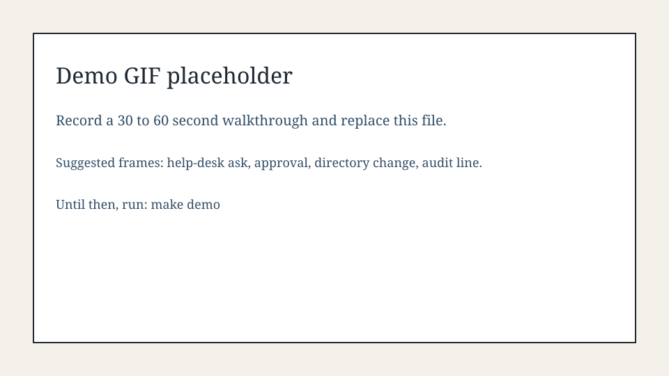
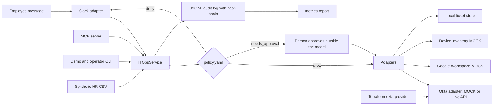

# JML-Agent

**Personal lab project. Synthetic data only. Not production, and not work done at any employer.**

JML-Agent is Asish Babu's personal portfolio lab: a small IT help-desk agent for a fake company directory. It exposes a narrow set of identity actions through a Python MCP server, gates every write on a policy file, waits for a person to approve, and writes a hash-chained audit log. Okta and Google Workspace sit behind adapters. The backends that run in this repo are labelled **MOCK**. A live Okta adapter turns on only when three environment variables are set together.

Nothing here is a claim about anyone's job history. The shape of the lab follows a public Senior IT Engineer posting (identity lifecycle, help-desk agents, Terraform). The posting is context for the exercise, not a statement that this code ran in that company.

Okta publishes an official MCP server ([okta/okta-mcp-server](https://github.com/okta/okta-mcp-server)). This project does not replace it. The point of this repo is the IT-operations layer around a few tools: least privilege, approval outside the model, an audit trail, and a small metrics report.

## Demo



That image is a placeholder. Record a 30–60 second GIF (ask, approval, directory change, audit line) and replace `docs/assets/demo-placeholder.svg`. Until then, the scripted walkthrough is:

```bash
make demo
```

## Quickstart

```bash
python3 -m venv .venv
source .venv/bin/activate
pip install -e ".[dev]"
cp .env.example .env
make test
make demo
python -m mcp_server.server --check
```

`--check` prints the backend labels and exits. With an empty `.env` those labels are `MOCK`.

Start the MCP server on stdio (mock mode, no accounts):

```bash
python -m mcp_server.server
```

An MCP client can launch it with no secrets:

```json
{
  "mcpServers": {
    "jml-agent": {
      "command": "jml-agent",
      "env": {"JML_DATA_DIR": "/absolute/path/var/mcp"}
    }
  }
}
```

Approve from the operator CLI, not from the model:

```bash
python -m mcp_server.admin --data-dir var/mcp decide \
  --id apr_... --approver morgan.lee@lab.example --decision approve --role it
python -m mcp_server.admin --data-dir var/mcp execute --id apr_... --actor operator@lab.example
python -m mcp_server.audit.verify_chain --audit var/mcp/audit.jsonl
```

Slack is optional. `python -m slack_bot.app` exits 0 and stays idle until `SLACK_BOT_TOKEN` and `SLACK_APP_TOKEN` are set. Install the extra with `pip install -e ".[slack]"`.

## Architecture



The dotted Terraform line is configuration for a tenant you connect yourself. CI validates it and does not apply it. Detail and a joiner sequence are in [docs/architecture.md](docs/architecture.md).

## Tools and least privilege

The model can call only the tools below. It cannot pass a URL or an API path. `decide` and `execute` are operator and Slack-button functions. They are not MCP tools, so the model cannot name an approver and approve itself.

Live Okta uses OAuth 2.0 private-key JWT. There is no SSWS API token in this code. If `OKTA_SCOPES` is unset on a live process, the process keeps only `okta.users.read` and `okta.groups.read`, and the write tools are not registered. The mock lab grants the scopes in the table so `make demo` can run. Okta's scopes are coarser than these tools; the policy file is the real gate.

| Tool | Kind | Default policy | Okta scopes |
|---|---|---|---|
| `lookup_user` | read | allow, allow-listed fields | `okta.users.read` |
| `list_user_groups` | read | allow | `okta.users.read`, `okta.groups.read` |
| `check_device_posture` | read | allow, mock inventory | none |
| `search_runbooks` | read | allow | none |
| `create_ticket` | local write | allow, audited | none |
| `request_group_access` | write | needs approval; `phi-*` needs manager and security | `okta.groups.manage` |
| `reset_mfa` | write | needs approval and an out-of-band identity check | `okta.users.manage` |
| `run_joiner` | write | needs approval; person must be in the HR file | `okta.users.manage`, `okta.groups.manage` |
| `run_mover` | write | needs approval | `okta.users.manage`, `okta.groups.manage` |
| `run_leaver` | write | needs approval; clears sessions, groups, Google mock, device assignment | `okta.users.manage`, `okta.groups.manage`, `okta.sessions.manage` |
| `suspend_user` | destructive | needs approval from two people, IT and security | `okta.users.manage`, `okta.sessions.manage` |

Unknown tools are denied. `phi-access` is a label. The lab has no health records, and a joiner never adds that group.

## Metrics

`make demo` prints a report from the audit log. Deflection counts runbook answers against escalated tickets. A joiner that a person approved is an automated fulfillment, not a deflection: a person was still in the loop. Durations are local and short because the demo does not wait on a human.

```text
IT ops metrics (synthetic lab)
deflected: 1
escalated: 1
deflection_rate: 50%
automated_fulfillments: 4
median_time_to_provision_seconds: 0.005
median_time_to_deprovision_seconds: 0.003
median_approval_seconds: 0.001
audit_entries: 27
audit_chain_ok: True
```

That block is one local `make demo` run. A later run keeps the same counts and moves the seconds by a few milliseconds.

```bash
python -m metrics.report --audit var/demo/audit.jsonl
```

## Threat model

| Threat | What we do about it |
|---|---|
| Prompt injection in a ticket or a reason | Tool arguments are data. They do not change `policy.yaml`. Tests cover this. |
| Confused deputy | Write tools return `pending_approval`. The model has no approve or execute tool. |
| Approval spoofing | The approver email is checked against a roster, and the requester cannot approve. Slack uses the clicker's email. |
| Stolen admin token | Live Okta uses a private-key JWT and scoped access. The key is not in git. |
| Over-broad tools | No tool accepts a free-form API path. Missing scopes mean the tool is not registered. |
| PHI leakage | Synthetic users only. Outputs are allow-listed. `phi-*` needs two roles. |
| Audit tampering | Each JSONL line includes the previous SHA-256. `verify_chain` fails closed. |

The longer write-up is [docs/threat-model.md](docs/threat-model.md). Design notes are in [docs/design-decisions.md](docs/design-decisions.md). A lab mapping of access control, audit, and minimum necessary — not a HIPAA or SOC 2 attestation — is in [docs/hipaa-soc2-notes.md](docs/hipaa-soc2-notes.md). A sample AI-use note is in [docs/ai-usage-policy.md](docs/ai-usage-policy.md).

## Layout

```text
mcp_server/          MCP server, policy, adapters, audit, approvals
slack_bot/           Optional Bolt adapter and the intent router
hris_mock/           Synthetic employees.csv and the event printer
metrics/             Deflection and time-to-provision report
runbooks/            Short articles the search tool can quote
terraform/okta/      Groups, group rules, bookmark apps, sign-on policy
workflows/okta/      Lab stand-ins for joiner, mover, and leaver flows
scripts/             bootstrap, leaver smoke test, macOS posture notes
tests/               pytest
.github/workflows/   lint + pytest, and terraform fmt/validate/plan
```

## Development

```bash
make lint
make test
bash scripts/leaver_smoke_test.sh
python -m hris_mock.emit_event
```

Terraform: [terraform/okta/README.md](terraform/okta/README.md). CI runs `fmt`, `init -backend=false`, and `validate`. It runs `plan` only when Okta secrets are present. It never runs `apply`.

Google Workspace commands that match the mock are listed in [docs/gam-equivalents.md](docs/gam-equivalents.md). The mock does not shell out to GAM.

`scripts/macos_collect_diag.sh` prints OS version and FileVault status on a Mac, skips the serial number, and does nothing on other operating systems.

## What this repo is not

- It is not a production help desk, and it is not deployed for an employer.
- It does not connect to Iru, Ravenna, ConductorOne, SentinelOne, Notion, or a real Google Workspace tenant. Those names appear only as the shape of a mock or a bookmark URL under `lab.example`.
- The people in `hris_mock/employees.csv` are invented. `@lab.example` is not a real mailbox.
- Workflow JSON under `workflows/okta/` is not an export from an Okta org.
