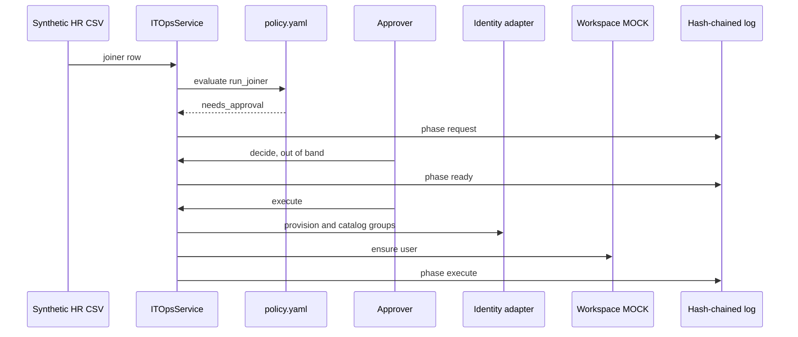

# Architecture

The process is one Python service with three doors: the MCP server, the optional Slack adapter, and the scripted demo. All three call `ITOpsService`. Policy, approval state, and the audit log live in that service. Adapters do not see the model.

## Backends

| Adapter | This repo | Live switch |
|---|---|---|
| Identity | `OktaMockAdapter` (`MOCK`) | `OktaLiveAdapter` when `OKTA_ORG_URL`, `OKTA_CLIENT_ID`, and `OKTA_PRIVATE_KEY_PATH` are all set |
| Google Workspace | `GoogleWorkspaceMock` (`MOCK`) | none |
| Devices | `DeviceInventoryMock` (`MOCK:device-inventory`) | none |
| Tickets | SQLite (`MOCK`) | none |

A partial Okta configuration refuses to start. The service will not silently keep the mock while some live variables are set.

State for the mock directory, tickets, and approvals is `jml.db` under `JML_DATA_DIR`. The audit log is `audit.jsonl` next to it. The HR CSV is read on startup into the database. The CSV in git stays the fixture.

## What the model is allowed to do

Registered tools are the rows in the README table whose scopes are in the process grant. A write returns `pending_approval` and an id. The stored parameters are what `execute` uses later. The model cannot swap the email at execution time, because execute is not a tool and it does not take a new email.

Runbooks are markdown with YAML front matter (`title`, `audience`, `tags`, `summary`). Search is keyword overlap. It does not run commands found in the query.
